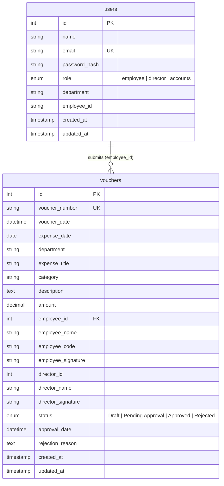

# Expense Voucher Management System

**Full Stack Developer Placement Assignment**  
*Prachay Securities Private Limited (PSPL)*

---

## 1. Overview & Executive Summary

The **Expense Voucher Management System** is a full-stack corporate web application designed to digitize and automate the manual expense voucher approval and reimbursement pipeline at **Prachay Securities Private Limited (PSPL)**.

The system replaces paper-based voucher workflows with a transparent, role-governed digital lifecycle connecting **Employees**, the **Director (Executive Approver)**, and the **Accounts Team (Reimbursement Monitors)**.

### Key Capabilities
- **Strict Role-Based Access Control (RBAC)** across Employee, Director, and Accounts roles.
- **Full Voucher Lifecycle Management**: `Draft` ➔ `Pending Approval` ➔ `Approved` / `Rejected`.
- **Mandatory Digital & Image Signatures**: Supports both interactive on-screen canvas drawing pads and image file uploads (PNG, JPG, WebP) with strict enforcement before submission and approval.
- **Search, Multi-Filter & Sorting (Bonus Feature)**: Multi-parameter search across Voucher Number, Employee Name, Department, Expense Category, Status, Date Ranges, and Claim Amount ranges.
- **Role-Tailored Executive Dashboards**: Specialized KPI metrics for each role as defined in the specification.
- **Printable Voucher Slip / Export**: Formatted physical print / PDF generation with company letterhead, expense itemization, and dual signature verification blocks.
- **Automated Test Suite**: 19 automated integration and unit test cases using Jest and Supertest verifying 100% of business rules, security boundaries, and edge cases.

---

## 2. Technology Stack & Architecture

```
┌─────────────────────────────────────────────────────────────┐
│                       Frontend (Client)                     │
│        React 18 + Vite + Tailwind CSS + Lucide Icons        │
│   (Role Dashboards, Signature Pad, Print Slips, Filters)    │
└───────────────────────────────┬─────────────────────────────┘
                                │ RESTful APIs (JSON / JWT)
┌───────────────────────────────▼─────────────────────────────┐
│                       Backend (Node.js)                     │
│                  Express.js Modular MVC API                 │
│    (Controllers, RBAC Middleware, Multer Uploads, Jest)     │
└───────────────────────────────┬─────────────────────────────┘
                                │ mysql2/promise Connection Pool
┌───────────────────────────────▼─────────────────────────────┐
│                     Database (MySQL 8.0)                    │
│      Relational Schema: users & vouchers with Foreign Keys  │
└─────────────────────────────────────────────────────────────┘
```

- **Frontend**:
  - React 18 (Vite build system)
  - Tailwind CSS for modern, humanized UI design
  - Lucide React for crisp, consistent iconography
  - HTML5 Canvas for real-time digital signature capture
- **Backend**:
  - Node.js (v20+) & Express.js
  - Architecture: Modular MVC (`controllers/`, `routes/`, `middleware/`, `validators/`, `utils/`, `config/`)
  - Authentication: JSON Web Tokens (JWT) with HTTP Bearer strategy
  - Password Security: `bcryptjs` with salt rounds
  - File Uploads: `multer` with file extension whitelisting and 2MB size cap
- **Database**:
  - MySQL 8.0 (InnoDB engine, utf8mb4 encoding, transaction locks, and relational constraints)
- **Testing**:
  - Jest & Supertest for end-to-end API integration tests

---

## 3. Database Schema Explanation

The relational model consists of two primary tables: `users` and `vouchers`.

### 3.1 Entity Relationship Diagram



### 3.2 Tables Breakdown

#### `users` Table
Stores authenticated corporate personnel and their access privileges.
- `id` (`INT UNSIGNED AUTO_INCREMENT PRIMARY KEY`): Unique user identifier.
- `name` (`VARCHAR(120)`): Full name of the user.
- `email` (`VARCHAR(190) UNIQUE`): Corporate email used for sign-in.
- `password_hash` (`VARCHAR(255)`): Secure one-way hashed password using bcrypt.
- `role` (`ENUM('employee', 'director', 'accounts')`): Determines route authorization and dashboard views.
- `department` (`VARCHAR(120)`): Department assignment (e.g., Engineering, Finance).
- `employee_id` (`VARCHAR(50)`): Optional corporate employee badge ID (e.g., `EMP-1042`).

#### `vouchers` Table
Stores expense claims through their complete approval lifecycle.
- `id` (`INT UNSIGNED AUTO_INCREMENT PRIMARY KEY`): Internal database record identifier.
- `voucher_number` (`VARCHAR(50) UNIQUE`): Unique auto-generated business identifier (e.g. `PSPL-2026-00001`).
- `voucher_date` (`DATETIME`): Record creation timestamp.
- `expense_date` (`DATE`): Date the expense was incurred.
- `department` (`VARCHAR(120)`): Department against which the claim is filed.
- `expense_title` (`VARCHAR(200)`): Short title summarizing the expense.
- `category` (`VARCHAR(100)`): Expense classification (Travel, Meals, Software & IT, Accommodation, etc.).
- `description` (`TEXT`): Detailed rationale and expense breakdown.
- `amount` (`DECIMAL(12, 2)`): Monetary value of the claim (must be > 0).
- `employee_id` (`INT UNSIGNED FK`): References `users(id)` with `ON DELETE CASCADE`.
- `employee_name` (`VARCHAR(120)`): Name of submitting employee.
- `employee_code` (`VARCHAR(50)`): Optional employee identification badge number.
- `employee_signature` (`VARCHAR(255)`): Path to the employee's authorization signature image.
- `director_id` & `director_name`: Identity of the approving Director.
- `director_signature` (`VARCHAR(255)`): Path to the Director's approval signature image.
- `status` (`ENUM('Draft', 'Pending Approval', 'Approved', 'Rejected')`): Current voucher status.
- `approval_date` (`DATETIME`): Timestamp when Director approved the voucher.
- `rejection_reason` (`TEXT`): Mandatory reason provided by Director if rejected.
- `created_at` & `updated_at`: Audit timestamps.

Indexes are created on `status`, `employee_id`, and `expense_date` for fast query performance.

---

## 4. Setup & Running Instructions

### 4.1 Prerequisites
- **Node.js**: v18.0.0 or higher
- **MySQL Server**: 8.0 or higher (running locally or remotely)
- **Git** & **VS Code**

### 4.2 Database Configuration
1. Ensure your local MySQL server is running (e.g. `MySQL80` service).
2. The backend includes automated migration that creates the database `pspl_expense_vouchers` and required tables automatically upon startup.
3. If you prefer to initialize MySQL manually via CLI:
   ```bash
   mysql -u root -p < backend/database/schema.sql
   ```

### 4.3 Backend Setup
1. Navigate to the `backend/` directory:
   ```bash
   cd backend
   ```
2. Copy `.env.example` to `.env`:
   ```bash
   # Windows PowerShell
   Copy-Item .env.example .env

   # macOS / Linux
   cp .env.example .env
   ```
3. Verify your MySQL credentials in `backend/.env`:
   ```env
   PORT=5000
   DB_HOST=127.0.0.1
   DB_PORT=3306
   DB_USER=root
   DB_PASSWORD=Root
   DB_NAME=pspl_expense_vouchers
   JWT_SECRET=prachay_securities_placement_assignment_super_secret_jwt_key_2026
   CLIENT_ORIGIN=http://localhost:5173
   ```
4. Install backend dependencies:
   ```bash
   npm install
   ```
5. Seed the database with demo accounts and initial vouchers:
   ```bash
   npm run seed
   ```
6. Start the backend development server:
   ```bash
   npm run dev
   ```
   *The backend will be available at `http://localhost:5000` with health check at `http://localhost:5000/api/health`.*

### 4.4 Frontend Setup
1. Open a new terminal and navigate to `frontend/`:
   ```bash
   cd frontend
   ```
2. Install frontend dependencies:
   ```bash
   npm install
   ```
3. Start the Vite development server:
   ```bash
   npm run dev
   ```
4. Open your browser and navigate to `http://localhost:5173`.

---

## 5. Demo Accounts

For convenient evaluation, the login screen features **1-Click Quick Demo Login** buttons for each role:

| Role | Name | Email | Password | Allowed Capabilities |
| :--- | :--- | :--- | :--- | :--- |
| **Employee** | Aarav Sharma | `employee@pspl.demo` | `Employee123!` | Create, save draft, edit draft, delete draft, sign & submit claims, view own claims |
| **Employee 2** | Neha Patel | `employee2@pspl.demo` | `Employee123!` | Used for testing employee data isolation |
| **Director** | Vikram Malhotra | `director@pspl.demo` | `Director123!` | View all organization claims, approve with signature, reject with mandatory reason |
| **Accounts** | Priya Sundaram | `accounts@pspl.demo` | `Accounts123!` | View all claims, verify signatures, print / download official reimbursement slips |

---

## 6. Running Automated Tests

A comprehensive suite of 19 automated integration test cases has been written using **Jest** and **Supertest** to test every business rule and permission boundary:

```bash
cd backend
npm test
```

### Test Coverage Highlights
- `auth.test.js`:
  - Valid user login and JWT generation
  - Invalid password rejection (401)
  - Missing credentials handling (400)
  - Protected profile route `/api/auth/me` verification
- `vouchers.test.js`:
  - New voucher saved as `Draft` with unique auto-generated number (`PSPL-YYYY-XXXXX`)
  - Validation of mandatory fields: Title, Department, Date, Amount > 0
  - Edit and delete draft voucher
  - Submission rejected if employee signature is missing (400)
  - Submission successful after signature attached (transitions to `Pending Approval`)
  - Immutability check: Submitted voucher cannot be edited or deleted by employee
  - Approval rejected if Director signature is missing (400)
  - Approval successful with Director signature (sets `Approved` & approval date)
  - Rejection rejected if reason is empty (400)
  - Rejection successful with reason (sets `Rejected` & persists reason)
- `rbac.test.js`:
  - **Employee Isolation**: Employee 1 cannot view or retrieve Employee 2 vouchers (403)
  - Director & Accounts can access all organization vouchers
  - Accounts team is strictly view-only (forbidden from creating, editing, approving, or deleting vouchers)
  - Employee cannot approve or reject vouchers (403)
  - Multi-parameter search, department filtering, amount range filtering, and sorting

---

## 7. RESTful API Documentation

All protected routes require an `Authorization: Bearer <token>` header.

### 7.1 Authentication Endpoints
- **`POST /api/auth/login`**
  - **Body**: `{ "email": "employee@pspl.demo", "password": "Employee123!" }`
  - **Response (200)**: `{ "token": "jwt_token...", "user": { "id": 1, "name": "...", "role": "employee" } }`
- **`GET /api/auth/me`**
  - **Response (200)**: `{ "user": { ... } }`

### 7.2 Voucher Management Endpoints
- **`GET /api/vouchers`**
  - Query parameters: `search`, `status`, `department`, `category`, `fromDate`, `toDate`, `minAmount`, `maxAmount`, `sortBy`, `sortOrder`.
  - Enforces employee isolation automatically.
- **`GET /api/vouchers/dashboard`**
  - Returns role-tailored KPI metrics for Employee, Director, or Accounts.
- **`GET /api/vouchers/:id`**
  - Retrieves full voucher details (checks role authorization).
- **`POST /api/vouchers`** *(Employee only)*
  - Creates a new voucher. Status is always initialized to `'Draft'`.
  - Body: `{ department, expenseTitle, expenseDate, category, description, amount, signatureBase64 }`
- **`PUT /api/vouchers/:id`** *(Employee only)*
  - Edits a voucher. Only permitted while voucher status is `'Draft'`.
- **`DELETE /api/vouchers/:id`** *(Employee only)*
  - Deletes a voucher. Only permitted while voucher status is `'Draft'`.
- **`POST /api/vouchers/:id/employee-signature`** *(Employee only)*
  - Uploads or updates the employee signature on a draft voucher.
- **`POST /api/vouchers/:id/submit`** *(Employee only)*
  - Submits draft for Director approval. Enforces mandatory employee signature check.
- **`POST /api/vouchers/:id/approve`** *(Director only)*
  - Approves a pending voucher. Enforces mandatory Director signature check.
- **`POST /api/vouchers/:id/reject`** *(Director only)*
  - Rejects a pending voucher. Enforces mandatory `reason` string.

---

## 8. Business Rules & Validations Enforced

1. **Unique Voucher Number**: Auto-generated sequentially with year prefix (e.g. `PSPL-2026-00001`) with transaction row locking.
2. **Draft Initialization**: All new vouchers are initially saved as `Draft`.
3. **Draft Editability**: Employees can edit or delete vouchers *only* while in `Draft` status.
4. **Immutability upon Submission**: Once submitted, vouchers become strictly read-only for employees.
5. **Mandatory Employee Signature**: A voucher cannot transition from `Draft` to `Pending Approval` without a verified employee signature.
6. **Mandatory Director Signature**: A voucher cannot transition from `Pending Approval` to `Approved` without a verified Director signature.
7. **Mandatory Rejection Remarks**: A voucher cannot be rejected without specific justification.
8. **Employee Isolation**: Employees can only view and manage vouchers they personally created.
9. **Accounts Team Read-Only Audit**: Accounts Team can view all organization vouchers and print official vouchers, but cannot alter voucher data or approve/reject.

---

## 9. Assumptions Made During Development

1. **Signature Storage**: Signatures are stored locally in the `uploads/signatures/` directory with unique timestamp identifiers and served via static route. In a cloud production environment, this would integrate with AWS S3 or Google Cloud Storage.
2. **Interactive Signature Pad**: In addition to standard file upload (PNG/JPG), an interactive canvas signature pad was added to allow drawing directly with a mouse or stylus.
3. **Sequential Numbering**: Voucher numbering is reset or scoped annually (`PSPL-YYYY-XXXXX`) to align with financial corporate accounting periods.
4. **Printable Vouchers**: The print feature is implemented as a print-optimized CSS layout utilizing browser print services (`window.print()`) which allows immediate printing or saving as PDF without external heavyweight PDF binary dependencies.

---

*Developed for the Full Stack Developer Placement Evaluation &bull; Prachay Securities Private Limited*